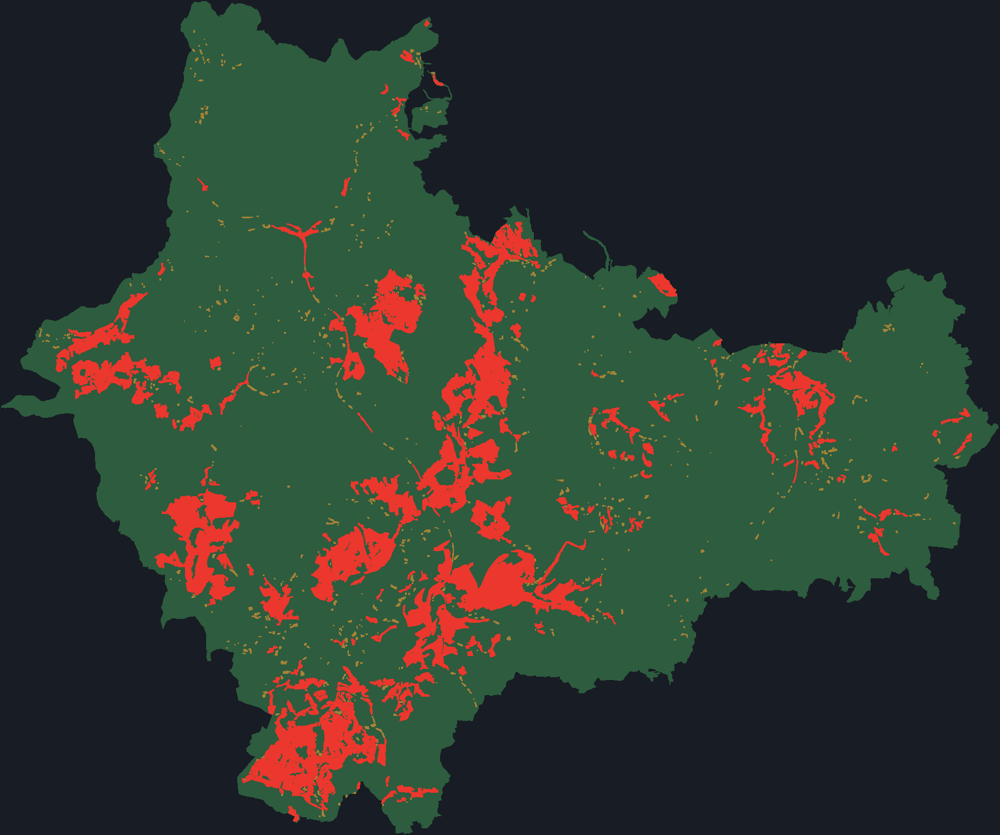

[English version below.](#english-version)

# osm-coverage-gaps

Schnelles, speichereffizientes Go-Kommandozeilenwerkzeug zur Erkennung unkartierter Flächen („weiße Flecken“) in OpenStreetMap-`.osm.pbf`-Extrakten.

## Funktionen

- **Dreistufiger PBF-Import:** Streamt nur benötigte Relationen, Ways und Nodes in kompakte planare `float32`-Meterkoordinaten mit dynamisch skalierender Node-ID-Kompaktierung, sodass landesweite Extrakte (wie ganz Deutschland) effizient im RAM verarbeitet werden können.
- **Flächentreue Projektion:** Sphärische flächentreue azimutale Lambert-Projektion (LAEA), zentriert auf den Zielextrakt, damit Rasterpixel und Polygongeometrien reale Oberflächengrößen in Hektar erhalten.
- **Optionale Maskierung von Küsten-Meeresflächen:** Unterstützt vorgefertigte WGS84-Landpolygone (EPSG:4326) von OSMData (`.shp`, `.zip` oder `.geojson`) mit schnellem BBox-Seeking, um 12-Seemeilen-Meeresgebiete aus Küstengrenzen auszuschneiden und im Übersichts-PNG blau darzustellen.
- **Konfigurierbare Overlay-Ausschlüsse:** Trennt physische Bodenbedeckung (Landcover) von funktionalen Container-Polygonen (wie Truppenübungsplätzen, Wintersportgebieten oder Windparks) über eingebaute Standardregeln, wiederholbare CLI-Tag-Regeln, Landcover-Vorrang und optionale LAEA-Polygonflächen-Schwellenwerte.
- **Bit-gepackte Rasterung und Morphologie:** Verwendet 1 Bit pro Pixel, Even-Odd-Scanline-Polygonfüllung (inklusive innerer Löcher) sowie bit-paralleles morphologisches Opening auf mehreren CPU-Kernen zur Unterdrückung schmaler Straßenkorridore und Splitterlücken.
- **Exakte Konturextraktion:** Dual-Grid-Konturverfolgung mit sauberer Trennung von Außenringen (CCW) und inneren Löchern (CW), gefolgt von Kollinearitätsbereinigung und geschlossener Douglas-Peucker-Vereinfachung.
- **Automatischer Vier-Dateien-Export:** Erzeugt bei jedem Lauf automatisch GeoJSON, CSV (mit OSM- und JOSM-RemoteControl-Links), ein Diagnose-Vorschaubild (PNG) sowie eine vollständige Diagnose-Logdatei.
- **Transparente Diagnostik:** Gibt wirksame Einstellungen, PBF-Header-Metadaten (`timestamp`, `writer`), Fortschritte pro Durchlauf, Meeresmaskierungs-Metriken, Pass-3-Prüfungen auf fehlende Nodes, Ring-Zusammenbau- und Polygonverlustzähler, erzeugte Dateigrößen sowie die 25 größten Lücken aus und protokolliert sie.

## CLI-Optionen

| Option | Typ | Standard | Beschreibung |
| :--- | :--- | :--- | :--- |
| `-pbf` | `string` | *(erforderlich)* | Pfad zur Eingabe-`.osm.pbf`-Datei (z. B. von Geofabrik). |
| `-land-polygons` | `string` | `""` | Optionale WGS84-Landpolygon-Quelle (EPSG:4326; `.shp`, `.zip`, Verzeichnis oder `.geojson`) von `osmdata.openstreetmap.de`, um Meeresflächen auszuschließen und blau darzustellen. |
| `-boundary-rel` | `int64` | `0` | Explizite OSM-Relations-ID für die Analysegrenze (z. B. `51477` für Deutschland). |
| `-boundary-name` | `string` | `""` | Expliziter `name`-Tag einer Verwaltungsgrenze, Abgleich ohne Berücksichtigung der Groß-/Kleinschreibung (z. B. `"Bayern"`). |
| `-res` | `float64` | `20.0` | Rasterpixelgröße in Metern (`5–10` für Regionen/Bundesländer, `20` für Länder). |
| `-min-ha` | `float64` | `5.0` | Mindestgröße einer gemeldeten unkartierten Lücke in Hektar. |
| `-opening` | `int` | `2` | Radius des morphologischen Openings in Pixeln zur Unterdrückung schmaler Straßenkorridore (`0` deaktiviert das Opening). |
| `-workers` | `int` | `NumCPU` | Anzahl paralleler Worker-Goroutinen für PBF-Dekodierung und Morphologie. |
| `-max-out` | `int` | `0` | Begrenzt die maximale Anzahl exportierter Lücken in GeoJSON und CSV (`0` exportiert alle). |
| `-ignore-area` | `rule` | *(wiederholbar)* | Schließt passende Flächenpolygone von den abgedeckten Flächen aus (`key=value`, `key=*`, `k1=v1&k2=v2` oder `<match>><max_ha>`). |
| `-no-default-ignores` | `bool` | `false` | Deaktiviert die eingebauten Overlay-Ausschlüsse (`military=training_area\|danger_area\|range`, `landuse=winter_sports\|conservation`). |

## Maskierung von Küsten-Meeresflächen (`-land-polygons`)

Verwaltungsgrenzen von Küstenländern und -staaten (wie Niedersachsen, Schleswig-Holstein, Mecklenburg-Vorpommern oder Deutschland) schließen die 12-Seemeilen-Hoheitsgewässer ein. Da OpenStreetMap Meere über `natural=coastline`-Linien statt über geschlossene Wasserpolygone modelliert, werden Meeresflächen innerhalb dieser Grenzen ohne `-land-polygons` als unkartierte Lücken gemeldet.

Wird `-land-polygons` angegeben, wird das Bitset der Analysegrenze vor der Berechnung der Abdeckungsstatistik mit der gerasterten Landmaske geschnitten (`boundary &= land`), und ausgeschlossene Meerespixel innerhalb der Grenze werden in `osm-coverage-gaps.png` **blau** (`#26568A`) dargestellt.

### OSMData-Landpolygone herunterladen (WGS84 / EPSG:4326)

FOSSGIS / OSMData veröffentlicht täglich topologisch reparierte Landpolygone, die aus globalen `natural=coastline`-Daten abgeleitet werden:

- **Informationsseite:** `https://osmdata.openstreetmap.de/data/land-polygons.html`
- **Direktdownload (WGS84, geteilt):** `https://osmdata.openstreetmap.de/download/land-polygons-split-4326.zip`

```bash
curl -LO https://osmdata.openstreetmap.de/download/land-polygons-split-4326.zip
unzip land-polygons-split-4326.zip
```

Für das schnellste BBox-Seeking sollte das entpackte Shapefile übergeben werden:

```bash
./osm-coverage-gaps \
  -pbf niedersachsen-latest.osm.pbf \
  -land-polygons land-polygons-split-4326/land_polygons.shp \
  -res 10
```

Alternativ können `land-polygons-split-4326.zip` direkt (ohne manuelles Entpacken), das entpackte Verzeichnis `land-polygons-split-4326` oder eine vorab zugeschnittene WGS84-`.geojson`-Datei angegeben werden.

> [!IMPORTANT]
> Verwenden Sie stets den geteilten **WGS84-Datensatz (`EPSG:4326`)** (`land-polygons-split-4326.zip`), nicht den Web-Mercator-Datensatz (`3857`). Web-Mercator-Shapefiles werden beim Start automatisch abgewiesen.

## Flächen-Ausschlussregeln (`-ignore-area`)

Große funktionale Container-Polygone in OSM umschließen oft unkartiertes Gelände, das erst dann als abgedeckt gelten sollte, wenn physische Bodenbedeckung (`landuse=forest`, `natural=scrub`, `natural=heath` usw.) darin erfasst ist. `-ignore-area` kann mehrfach angegeben werden, um solche Polygone von den abgedeckten Flächen auszuschließen.

### Regelsyntax

| Muster | Bedeutung | Beispiel |
| :--- | :--- | :--- |
| `key=value` | Ignoriert passende Polygone bedingungslos in Pass 1/2. | `landuse=military` |
| `key=*` | Ignoriert Polygone mit beliebigem nicht-leerem Wert für `key` bedingungslos. | `military=*` |
| `k1=v1&k2=v2` | Konjunktiver Abgleich: Alle Tag-Bedingungen müssen gleichzeitig zutreffen. | `power=plant&plant:source=wind` |
| `<match>><max_ha>` | Ignoriert passende Polygone, deren Netto-LAEA-Fläche `<max_ha>` Hektar überschreitet; kleinere Polygone bleiben abgedeckt. | `landuse=military>50` |

> [!TIP]
> Setzen Sie Regeln mit `>`, `&` oder `*` in Ihrer Shell in Anführungszeichen (z. B. `-ignore-area "landuse=military>50"` oder `-ignore-area "power=plant&plant:source=wind"`), um Shell-Umleitungen oder Glob-Expansionen zu verhindern.

### Eingebaute Standardregeln und Landcover-Vorrang

Sofern `-no-default-ignores` nicht gesetzt ist, sind fünf Overlay-Ausschlüsse automatisch aktiv:

- `military=training_area`
- `military=danger_area`
- `military=range`
- `landuse=winter_sports`
- `landuse=conservation`

Trifft eine Ausschlussregel auf ein Element zu, unterdrückt sie alle **funktionalen** Abdeckungs-Tags dieses Elements gemeinsam (z. B. neutralisiert `military=training_area` auch ein begleitendes `landuse=military` auf derselben Relation). **Physische Landcover-Tags** (`landcover=*`, `natural=*`, `water=*`, `landuse=forest`, `landuse=meadow` usw.) behalten auf doppelt getaggten Polygonen Vorrang, sofern keine Ausschlussregel ausdrücklich auf diesen Landcover-Schlüssel zielt (z. B. `-ignore-area landuse=farmland`).

## Erzeugte Ausgabedateien

Jeder Lauf schreibt vier Ausgabedateien mit festen Dateinamen in das aktuelle Arbeitsverzeichnis:

| Datei | Format | Inhalt |
| :--- | :--- | :--- |
| `osm-coverage-gaps.geojson` | RFC 7946 GeoJSON | Nach Größe geordnete `FeatureCollection` aus `Polygon`-Geometrien (mit Löchern), Kennzahlen sowie OSM-/JOSM-Links. |
| `osm-coverage-gaps.csv` | CSV | Rangliste der Lücken mit Fläche, Pixelanzahl, Zentroid-Koordinaten und direkten OSM-/JOSM-Links. |
| `osm-coverage-gaps.png` | PNG | Herunterskaliertes Diagnose-Übersichtsbild (max. 1800 px Kantenlänge) mit Abdeckung, optional blauen Meeresflächen und erkannten Lücken. |
| `osm-coverage-gaps.log` | Klartext | Vollständiges Laufprotokoll mit Einstellungen, PBF-Header-Metadaten, Fortschrittsmeldungen, Geometrieverlustzählern, Zusammenfassung sowie dateiexklusiven `[DIAG]`-Einträgen für verworfene/unvollständige Ways, Relationen und flächenbasierte Ausschlüsse. |

## Anwendungsbeispiele

### 1. Minimaler Lauf mit automatischer Grenzerkennung und Standardwerten

```bash
./osm-coverage-gaps -pbf niedersachsen-latest.osm.pbf
```

### 2. Hochauflösende Bundesland-Analyse mit kleinerem Schwellenwert

```bash
./osm-coverage-gaps \
  -pbf bayern-latest.osm.pbf \
  -res 10 \
  -min-ha 2.5
```

### 3. Bundesweite Deutschland-Analyse über explizite Relations-ID mit Export- und Worker-Limit

```bash
./osm-coverage-gaps \
  -pbf germany-latest.osm.pbf \
  -boundary-rel 51477 \
  -res 20 \
  -min-ha 10 \
  -opening 2 \
  -max-out 500 \
  -workers 8
```

### 4. Teilgebietsanalyse über den Namen einer Verwaltungsgrenze

```bash
./osm-coverage-gaps \
  -pbf nordrhein-westfalen-latest.osm.pbf \
  -boundary-name "Münster" \
  -res 5 \
  -min-ha 1.0
```

### 5. Rohanalyse ohne morphologisches Opening

```bash
./osm-coverage-gaps \
  -pbf saarland-latest.osm.pbf \
  -opening 0 \
  -res 5 \
  -min-ha 0.5
```

### 6. Große untypisierte Militärflächen und Flugplätze über LAEA-Flächenschwellen ausschließen

Hält kleine Kasernen ($\le 50\text{ ha}$) und kleine Flugplätze ($\le 30\text{ ha}$) als abgedeckt, legt jedoch unkartiertes Gelände innerhalb großer Truppenübungsplätze und Flughäfen offen:

```bash
./osm-coverage-gaps \
  -pbf niedersachsen-latest.osm.pbf \
  -res 10 \
  -ignore-area "landuse=military>50" \
  -ignore-area "aeroway=aerodrome>30"
```

### 7. Alle Militärflächen und Windparks über konjunktive Tag-Regeln ausschließen

```bash
./osm-coverage-gaps \
  -pbf brandenburg-latest.osm.pbf \
  -ignore-area landuse=military \
  -ignore-area "power=plant&plant:source=wind"
```

### 8. Eingebaute Overlay-Standardregeln deaktivieren

Behandelt `military=training_area`, `military=danger_area`, `military=range`, `landuse=winter_sports` und `landuse=conservation` wieder als abgedeckte Flächen:

```bash
./osm-coverage-gaps \
  -pbf bayern-latest.osm.pbf \
  -no-default-ignores
```

### 9. Küstenland-Analyse mit Ausschluss von Meeresflächen über OSMData-Landpolygone

Schneidet 12-Seemeilen-Nordseeflächen aus der Grenze Niedersachsens aus und stellt sie in `osm-coverage-gaps.png` blau dar:

```bash
./osm-coverage-gaps \
  -pbf niedersachsen-latest.osm.pbf \
  -land-polygons land-polygons-split-4326/land_polygons.shp \
  -res 10
```

## Funktionsweise


### Als abgedeckte Fläche behandelte OSM-Tags (`internal/osmtags`)

| Schlüssel | Klasse | Regel |
| :--- | :--- | :--- |
| `landcover`, `water` | Physisch | Alle Werte außer `no`. |
| `natural` | Physisch | Alle Werte außer Punkt-/Linienobjekten (`tree`, `tree_row`, `cliff`, `peak`, `coastline` usw.) und topografischen Regionen (`peninsula`, `mountain_range`, `massif`, `plateau`, `archipelago`, `isthmus`, `arete`, `hill`, `gorge`, `canyon`). |
| `landuse` | Physisch / Funktional | Physische Oberflächen (`forest`, `farmland`, `meadow`, `residential`, `industrial` usw.) genießen Landcover-Vorrang; funktionale Overlays (`military`, `winter_sports`, `conservation` usw.) unterliegen den Overlay-Ausschlüssen (`winter_sports` und `conservation` sind standardmäßig ausgeschlossen). |
| `waterway` | Physisch | `riverbank`, `dock`, `boatyard`, `dam`. |
| `place` | Physisch | `square`. |
| `highway`, `railway` | Physisch | Nur in Kombination mit `area=yes`. |
| `leisure` | Funktional | Alle Werte außer `no`, `nature_reserve`, `track`, `slipway`, `picnic_table`, `firepit`, `bird_hide`, `fishing`. |
| `amenity`, `aeroway`, `tourism`, `power`, `man_made` | Funktional | Kuratierte Flächen-Allowlists (z. B. `school`, `parking`, `aerodrome`, `camp_site`, `plant`, `works`). |
| `military` | Funktional | Alle Werte außer `no` und `bunker` (`training_area`, `danger_area`, `range` sind standardmäßig ausgeschlossen). |

> [!NOTE]
> `leisure=nature_reserve` wird bedingungslos ausgeschlossen, damit unkartierte Bereiche innerhalb von Naturschutzgebieten sichtbar bleiben. Die eingebauten Standardregeln schließen zusätzlich `military=training_area`, `military=danger_area`, `military=range`, `landuse=winter_sports` und `landuse=conservation` aus.

### Farblegende der Vorschau-PNG (`osm-coverage-gaps.png`)

| Farbe | Hex | Bedeutung |
| :--- | :--- | :--- |
| Dunkles Schiefergrau | `#181C24` | Außerhalb der aktiven Analysegrenze. |
| Blau | `#26568A` | Über `-land-polygons` ausgeschlossene Meeresflächen innerhalb der Verwaltungsgrenze. |
| Grün | `#2D5C3E` | Kartierte Flächenabdeckung (einschließlich durch `-opening` unterdrückter schmaler Korridore). |
| Ocker / Braun | `#A58237` | Verbleibende unkartierte Lücken nach dem Opening unterhalb von `-min-ha` (nicht exportiert). |
| Rot / Orangerot | `#EB372D` | Qualifizierende unkartierte Lücken `>= -min-ha` (in GeoJSON und CSV exportiert). |

## Ausgabeformate, JOSM-Workflow und Diagnostik

### GeoJSON (`osm-coverage-gaps.geojson`)

`FeatureCollection` mit `Polygon`-Features (inkl. Außen- und Innenringen/Löchern) und folgenden `properties`:

```json
{
  "rank": 1,
  "area_ha": 42.68,
  "pixels": 1067,
  "center_lat": 51.961234,
  "center_lon": 7.628901,
  "osm_url": "https://www.openstreetmap.org/#map=15/51.96123/7.62890",
  "josm_url": "http://127.0.0.1:8111/load_and_zoom?left=7.621000&right=7.636000&top=51.966000&bottom=51.956000"
}
```

### CSV (`osm-coverage-gaps.csv`) und JOSM-Fernsteuerung

Spalten: `rank,area_ha,pixels,center_lat,center_lon,osm_url,josm_url`.

So öffnen Sie `josm_url`-Einträge direkt in JOSM:

1. Starten Sie JOSM und aktivieren Sie **Einstellungen → Fernsteuerung → Fernsteuerung aktivieren** (lauscht lokal auf `127.0.0.1:8111`).
2. **LibreOffice Calc:** CSV-URLs werden als Klartext importiert; fügen Sie eine Hilfsspalte wie `=HYPERLINK(G2; "In JOSM laden")` hinzu (bei englischer Lokalisierung `,` statt `;`).
3. **QGIS / Terminal (ohne Browser-Tabs zu öffnen):** Senden Sie die URL per `curl` und holen Sie JOSM in den Vordergrund (unter macOS: `curl -s "<josm_url>" >/dev/null && open -a JOSM`).

### Diagnose-Log (`osm-coverage-gaps.log`)

`osm-coverage-gaps.log` spiegelt die gesamte Konsolenausgabe (Starteinstellungen, Fortschrittsmeldungen und Abschlusszusammenfassung) und protokolliert zusätzlich objektbezogene `[DIAG]`-Einträge für:

- Verworfene eigenständige oder bedingte Ways (`drop standalone_way`, `drop conditional_way`)
- Verworfene oder nur teilweise zusammengesetzte Multipolygon-Relationen (`drop relation`, `partial relation` mit exakter OSM-Relations-ID, fehlenden Ways, offenen Ketten und fehlenden Nodes)
- Polygone, die aufgrund von `-ignore-area`-LAEA-Flächenschwellen übersprungen wurden (`skip_area`)

Nützliche Prüfkommandos nach einem Lauf:

```bash
# PBF-Zeitstempel, fehlende Nodes in Pass 3, Landmasken-Statistik und aggregierte Rasterungsverluste prüfen:
grep -E "PBF header:|Pass 3 completed|Applied land polygon mask|Rasterization completed" osm-coverage-gaps.log

# Verworfene oder unvollständige Multipolygon-Relationen mit ihren OSM-IDs auflisten:
grep -E "drop relation|partial relation" osm-coverage-gaps.log | head -n 30
```

### Konsolenausgabe

1. **Starteinstellungen:** Listet vor Beginn von Pass 1 jeden wirksamen CLI-Parameter (einschließlich `-land-polygons`), aktive Overlay-Standardregeln und Ausschlussregeln, die abgeleitete Mindestpixelanzahl sowie alle vier Ausgabedateipfade auf.
2. **Fortschrittsmeldungen:** Zeitstempel und Kennzahlen für PBF-Header-Metadaten (`timestamp`, `writer`), jeden PBF-Durchlauf (einschließlich per Regel ignorierter, flächenbegrenzter und fehlender Elemente), Grenzauswahl, Rasterallokation, optionale Landpolygon-Maskierung, Rasterung (einschließlich flächenbedingt übersprungener Polygone und Geometrieverluste), morphologisches Opening, Flood-Fill-Extraktion und Dateiexport.
3. **Abschlusszusammenfassung:** Berichtet Gesamtlaufzeit, PBF-Datenzeitstempel, Analysegrenze, Rasterabmessungen, Analysefläche, optional ausgeschlossene Meeresfläche, prozentuale Flächenabdeckung, Anzahl ignorierter Polygone (nach Tag und Fläche), fehlende Nodes in Pass 3, verworfene Ways und Relationen, Relationsverlust-Summen (`way/inc/node`), unkartierte Fläche vor und nach dem Opening, Anzahl qualifizierender und exportierter Lücken, Größenverteilung (`max/avg/med/min`), erzeugte Dateigrößen sowie die 25 größten Lücken mit direkten OSM-URLs.

### Praktisches Beispiel

```text
./osm-coverage-gaps -pbf bayern-latest.osm.pbf -boundary-name "Landkreis Bad Kissingen" -res 10
...
Summary:
  Total runtime              : 7.692s
  PBF data timestamp         : 2026-11-20T21:21:21Z
  Analysis boundary          : Relation 62406 (Landkreis Bad Kissingen, admin_level=6) (1 rings)
  Raster dimensions          : 5321 x 4442 px (10 m/px)
  Analysis area              : 113315.25 ha (1133.15 km²)
  Covered area               : 96460.42 ha (85.13%)
  Ignored areas              : 198 by tag, 0 by area
  Missing nodes (Pass 3)     : 0
  Dropped ways (missing)     : 0 standalone, 0 conditional
  Dropped rels (no outer)    : 6 (4 partial loss)
  Rel losses (way/inc/node)  : 31/9/0
  Unmapped area (raw)        : 16854.83 ha (14.87%)
  Unmapped area (opened)     : 14686.00 ha (12.96%)
  Qualifying gaps found      : 182 (>= 5.00 ha)
  Exported gaps              : 182
  Qualifying gap area        : 13689.04 ha (12.08% of analysis area)
  Gap size (max/avg/med/min) : 1584.41 / 75.21 / 12.23 / 5.05 ha

Generated files:
  GeoJSON : osm-coverage-gaps.geojson (1.07 MB, 182 features)
  CSV     : osm-coverage-gaps.csv (33.0 KB, 182 rows)
  PNG     : osm-coverage-gaps.png (105.8 KB, 1800 x 1503 px)
  Log     : osm-coverage-gaps.log (5.5 KB)

Top 25 gaps (of 182 found):
  # 1   1584.41 ha  (50.06728,   9.86183)  https://www.openstreetmap.org/#map=15/50.06728/9.86183
  # 2   1480.48 ha  (50.14722,   9.99391)  https://www.openstreetmap.org/#map=15/50.14722/9.99391
  # 3   1152.51 ha  (50.16783,   9.77567)  https://www.openstreetmap.org/#map=15/50.16783/9.77567
  ...
  #23     66.58 ha  (50.26174,  10.20426)  https://www.openstreetmap.org/#map=15/50.26174/10.20426
  #24     65.83 ha  (50.23710,   9.72781)  https://www.openstreetmap.org/#map=15/50.23710/9.72781
  #25     63.48 ha  (50.31475,   9.84367)  https://www.openstreetmap.org/#map=15/50.31475/9.84367
```



---

<a id="english-version"></a>

# osm-coverage-gaps

Fast, memory-efficient Go command-line tool for detecting unmapped surface areas ("white spots") in OpenStreetMap `.osm.pbf` extracts.

## Features

- **Three-pass PBF import:** Streams only required relations, ways, and nodes into compact `float32` planar meter coordinates with dynamically scaling node-ID compaction, allowing nationwide extracts (such as all of Germany) to run efficiently in RAM.
- **Equal-area projection:** Spherical Lambert Azimuthal Equal-Area (LAEA) projection centered on the target extract so raster pixels and polygon geometries preserve real-world surface area in hectares.
- **Optional coastal sea-area masking:** Supports pre-built WGS84 (EPSG:4326) OSMData land polygons (`.shp`, `.zip`, or `.geojson`) with fast BBox seeking to clip 12 nm sea areas from coastal boundaries and render them blue in the overview PNG.
- **Configurable overlay exclusions:** Separates physical landcover from functional container polygons (such as military training areas, winter sports resorts, or wind farms) with built-in defaults, repeatable CLI tag rules, landcover precedence, and optional LAEA polygon area thresholds.
- **Bit-packed rasterization and morphology:** Uses 1 bit per pixel, even-odd scanline polygon filling (including inner holes), and multi-core bit-parallel morphological opening to suppress narrow road corridors and sliver gaps.
- **Exact contour extraction:** Dual-grid contour tracing with clean separation of outer rings (CCW) and interior holes (CW), followed by collinearity pruning and closed-loop Douglas-Peucker simplification.
- **Always-on four-file export:** Automatically generates GeoJSON, CSV (with OSM and JOSM RemoteControl links), a diagnostic preview PNG, and a complete diagnostic log file on every run.
- **Transparent diagnostics:** Prints and logs effective settings, PBF header metadata (`timestamp`, `writer`), per-pass progress, sea-masking metrics, Pass-3 missing-node checks, ring-assembly and polygon-loss counters, generated file sizes, and the top 25 largest gaps.

## CLI Options

| Option | Type | Default | Description |
| :--- | :--- | :--- | :--- |
| `-pbf` | `string` | *(required)* | Specify the path to the input `.osm.pbf` file (for example, from Geofabrik). |
| `-land-polygons` | `string` | `""` | Specify an optional WGS84 (EPSG:4326) land-polygon source (`.shp`, `.zip`, directory, or `.geojson`) from `osmdata.openstreetmap.de` to exclude sea areas and render them blue. |
| `-boundary-rel` | `int64` | `0` | Specify an explicit OSM relation ID for the analysis boundary (for example, `51477` for Germany). |
| `-boundary-name` | `string` | `""` | Specify an explicit administrative boundary `name` tag matched case-insensitively (for example, `"Bayern"`). |
| `-res` | `float64` | `20.0` | Set the raster pixel size in meters (`5–10` for regions/states, `20` for countries). |
| `-min-ha` | `float64` | `5.0` | Set the minimum size of a reported unmapped gap in hectares. |
| `-opening` | `int` | `2` | Set the morphological opening radius in pixels to suppress narrow road corridors (`0` disables opening). |
| `-workers` | `int` | `NumCPU` | Set the number of parallel worker goroutines for PBF decoding and morphology. |
| `-max-out` | `int` | `0` | Limit the maximum number of exported gaps in GeoJSON and CSV outputs (`0` exports all). |
| `-ignore-area` | `rule` | *(repeatable)* | Exclude matching area polygons from covered surfaces (`key=value`, `key=*`, `k1=v1&k2=v2`, or `<match>><max_ha>`). |
| `-no-default-ignores` | `bool` | `false` | Disable built-in overlay exclusions (`military=training_area\|danger_area\|range`, `landuse=winter_sports\|conservation`). |

## Coastal Sea-Area Masking (`-land-polygons`)

Administrative boundaries of coastal states and countries (such as Niedersachsen, Schleswig-Holstein, Mecklenburg-Vorpommern, or Germany) include 12-nautical-mile territorial sea zones. Because OpenStreetMap models oceans via `natural=coastline` lines rather than closed water polygons, sea areas inside those boundaries are reported as unmapped gaps when `-land-polygons` is omitted.

When `-land-polygons` is supplied, the analysis boundary bitset is intersected with the rasterized land mask (`boundary &= land`) before coverage statistics are computed, and excluded sea pixels inside the boundary are rendered **blue** (`#26568A`) in `osm-coverage-gaps.png`.

### Download OSMData Land Polygons (WGS84 / EPSG:4326)

FOSSGIS / OSMData publishes daily, topologically repaired land polygons derived from global `natural=coastline` data:

- **Information page:** `https://osmdata.openstreetmap.de/data/land-polygons.html`
- **Direct download (WGS84, split):** `https://osmdata.openstreetmap.de/download/land-polygons-split-4326.zip`

```bash
curl -LO https://osmdata.openstreetmap.de/download/land-polygons-split-4326.zip
unzip land-polygons-split-4326.zip
```

Pass the unzipped shapefile for fastest BBox seeking:

```bash
./osm-coverage-gaps \
  -pbf niedersachsen-latest.osm.pbf \
  -land-polygons land-polygons-split-4326/land_polygons.shp \
  -res 10
```

Alternatively, pass `land-polygons-split-4326.zip` directly (no manual extraction required), the extracted directory `land-polygons-split-4326`, or a pre-clipped WGS84 `.geojson` file.

> [!IMPORTANT]
> Always use the **WGS84 (`EPSG:4326`)** split dataset (`land-polygons-split-4326.zip`), not the Web Mercator (`3857`) dataset. Web Mercator shapefiles are rejected automatically at startup.

## Area Exclusion Rules (`-ignore-area`)

Large functional container polygons in OSM often surround unmapped terrain that should only count as covered once physical landcover (`landuse=forest`, `natural=scrub`, `natural=heath`, etc.) is mapped inside them. `-ignore-area` can be passed multiple times to exclude such polygons from covered surfaces.

### Rule Syntax

| Pattern | Meaning | Example |
| :--- | :--- | :--- |
| `key=value` | Unconditionally ignore matching polygons in Pass 1/2. | `landuse=military` |
| `key=*` | Unconditionally ignore polygons with any non-empty value for `key`. | `military=*` |
| `k1=v1&k2=v2` | Conjunctive match requiring all tag conditions to hold simultaneously. | `power=plant&plant:source=wind` |
| `<match>><max_ha>` | Ignore matching polygons whose net LAEA area exceeds `<max_ha>` hectares; smaller polygons remain covered. | `landuse=military>50` |

> [!TIP]
> Quote rules containing `>`, `&`, or `*` in your shell (for example, `-ignore-area "landuse=military>50"` or `-ignore-area "power=plant&plant:source=wind"`) to prevent shell redirection or glob expansion.

### Built-in Defaults and Landcover Precedence

Unless `-no-default-ignores` is specified, five overlay exclusions are active automatically:

- `military=training_area`
- `military=danger_area`
- `military=range`
- `landuse=winter_sports`
- `landuse=conservation`

When an exclusion rule matches an element, it suppresses all **functional** coverage tags on that element together (for example, `military=training_area` also neutralizes a companion `landuse=military` tag on the same relation). **Physical landcover** tags (`landcover=*`, `natural=*`, `water=*`, `landuse=forest`, `landuse=meadow`, etc.) retain precedence on dual-tagged polygons unless an exclusion rule explicitly targets that landcover key (for example, `-ignore-area landuse=farmland`).

## Generated Output Files

Every run writes four output files into the current working directory using fixed filenames:

| File | Format | Contents |
| :--- | :--- | :--- |
| `osm-coverage-gaps.geojson` | RFC 7946 GeoJSON | Ranked `FeatureCollection` of `Polygon` geometries (with holes), metrics, and OSM/JOSM links. |
| `osm-coverage-gaps.csv` | CSV | Ranked gap table with area, pixel count, centroid coordinates, and direct OSM/JOSM links. |
| `osm-coverage-gaps.png` | PNG | Downscaled diagnostic overview image (max. 1800 px edge length) of coverage, optional blue sea areas, and detected gaps. |
| `osm-coverage-gaps.log` | Plain text | Full run log mirroring settings, PBF header metadata, progress logs, geometry loss counters, summary, plus file-only `[DIAG]` entries for dropped/incomplete ways, relations, and area-threshold skips. |

## Usage Examples

### 1. Minimal run with automatic boundary detection and default settings

```bash
./osm-coverage-gaps -pbf niedersachsen-latest.osm.pbf
```

### 2. High-resolution federal state analysis with a smaller gap threshold

```bash
./osm-coverage-gaps \
  -pbf bayern-latest.osm.pbf \
  -res 10 \
  -min-ha 2.5
```

### 3. Nationwide Germany analysis using an explicit relation ID with export and worker limits

```bash
./osm-coverage-gaps \
  -pbf germany-latest.osm.pbf \
  -boundary-rel 51477 \
  -res 20 \
  -min-ha 10 \
  -opening 2 \
  -max-out 500 \
  -workers 8
```

### 4. Subregion analysis selected by administrative boundary name

```bash
./osm-coverage-gaps \
  -pbf nordrhein-westfalen-latest.osm.pbf \
  -boundary-name "Münster" \
  -res 5 \
  -min-ha 1.0
```

### 5. Raw gap analysis without morphological opening

```bash
./osm-coverage-gaps \
  -pbf saarland-latest.osm.pbf \
  -opening 0 \
  -res 5 \
  -min-ha 0.5
```

### 6. Exclude large untyped military areas and airfields by LAEA area threshold

Keeps small military barracks ($\le 50\text{ ha}$) and small airfields ($\le 30\text{ ha}$) covered while exposing unmapped terrain inside large military training areas and airports:

```bash
./osm-coverage-gaps \
  -pbf niedersachsen-latest.osm.pbf \
  -res 10 \
  -ignore-area "landuse=military>50" \
  -ignore-area "aeroway=aerodrome>30"
```

### 7. Exclude all military areas and wind farms via conjunctive tag rules

```bash
./osm-coverage-gaps \
  -pbf brandenburg-latest.osm.pbf \
  -ignore-area landuse=military \
  -ignore-area "power=plant&plant:source=wind"
```

### 8. Disable built-in overlay defaults

Treats `military=training_area`, `military=danger_area`, `military=range`, `landuse=winter_sports`, and `landuse=conservation` as covered surfaces again:

```bash
./osm-coverage-gaps \
  -pbf bayern-latest.osm.pbf \
  -no-default-ignores
```

### 9. Coastal state analysis excluding sea areas with OSMData land polygons

Clips 12 nm North Sea areas from the Niedersachsen boundary and renders them blue in `osm-coverage-gaps.png`:

```bash
./osm-coverage-gaps \
  -pbf niedersachsen-latest.osm.pbf \
  -land-polygons land-polygons-split-4326/land_polygons.shp \
  -res 10
```

## How It Works


### OSM Tags Treated as Covered Surface (`internal/osmtags`)

| Key | Class | Rule |
| :--- | :--- | :--- |
| `landcover`, `water` | Physical | All values except `no`. |
| `natural` | Physical | All values except point/linear features (`tree`, `tree_row`, `cliff`, `peak`, `coastline`, etc.) and topographic regions (`peninsula`, `mountain_range`, `massif`, `plateau`, `archipelago`, `isthmus`, `arete`, `hill`, `gorge`, `canyon`). |
| `landuse` | Physical / Functional | Physical surfaces (`forest`, `farmland`, `meadow`, `residential`, `industrial`, etc.) take landcover precedence; functional overlays (`military`, `winter_sports`, `conservation`, etc.) are subject to overlay exclusions (`winter_sports` and `conservation` excluded by default). |
| `waterway` | Physical | `riverbank`, `dock`, `boatyard`, `dam`. |
| `place` | Physical | `square`. |
| `highway`, `railway` | Physical | Only in combination with `area=yes`. |
| `leisure` | Functional | All values except `no`, `nature_reserve`, `track`, `slipway`, `picnic_table`, `firepit`, `bird_hide`, `fishing`. |
| `amenity`, `aeroway`, `tourism`, `power`, `man_made` | Functional | Curated areal allowlists (for example, `school`, `parking`, `aerodrome`, `camp_site`, `plant`, `works`). |
| `military` | Functional | All values except `no` and `bunker` (`training_area`, `danger_area`, `range` excluded by default). |

> [!NOTE]
> `leisure=nature_reserve` is excluded unconditionally so unmapped areas inside nature reserves remain visible. Built-in defaults additionally exclude `military=training_area`, `military=danger_area`, `military=range`, `landuse=winter_sports`, and `landuse=conservation`.

### Preview PNG Color Legend (`osm-coverage-gaps.png`)

| Color | Hex | Meaning |
| :--- | :--- | :--- |
| Dark slate | `#181C24` | Outside the active analysis boundary. |
| Blue | `#26568A` | Sea areas inside the administrative boundary excluded via `-land-polygons`. |
| Green | `#2D5C3E` | Mapped surface coverage (including narrow corridors suppressed by `-opening`). |
| Ochre / Brown | `#A58237` | Remaining unmapped gaps after opening that fall below `-min-ha` (not exported). |
| Red / Orange-red | `#EB372D` | Qualifying unmapped gaps `>= -min-ha` (exported to GeoJSON and CSV). |

## Output Formats, JOSM Workflow, and Diagnostics

### GeoJSON (`osm-coverage-gaps.geojson`)

`FeatureCollection` containing `Polygon` features (with exterior and interior hole rings) and the following `properties`:

```json
{
  "rank": 1,
  "area_ha": 42.68,
  "pixels": 1067,
  "center_lat": 51.961234,
  "center_lon": 7.628901,
  "osm_url": "https://www.openstreetmap.org/#map=15/51.96123/7.62890",
  "josm_url": "http://127.0.0.1:8111/load_and_zoom?left=7.621000&right=7.636000&top=51.966000&bottom=51.956000"
}
```

### CSV (`osm-coverage-gaps.csv`) and JOSM RemoteControl

Columns: `rank,area_ha,pixels,center_lat,center_lon,osm_url,josm_url`.

To open `josm_url` entries directly in JOSM:

1. Start JOSM and enable **Preferences → Remote Control → Enable remote control** (listens locally on `127.0.0.1:8111`).
2. **LibreOffice Calc:** CSV URLs import as plain text; add a helper column such as `=HYPERLINK(G2; "Load in JOSM")` (or `,` on English locales).
3. **QGIS / Terminal (without opening browser tabs):** Send the URL via `curl` and bring JOSM to the front (on macOS: `curl -s "<josm_url>" >/dev/null && open -a JOSM`).

### Diagnostic Log (`osm-coverage-gaps.log`)

`osm-coverage-gaps.log` mirrors all console output (startup settings, progress logs, and final summary) and additionally records per-object `[DIAG]` entries for:

- Dropped standalone or conditional ways (`drop standalone_way`, `drop conditional_way`)
- Dropped or partially assembled multipolygon relations (`drop relation`, `partial relation` with exact OSM relation ID, missing ways, open chains, and missing nodes)
- Polygons skipped due to `-ignore-area` LAEA area thresholds (`skip_area`)

Useful inspection commands after a run:

```bash
# Inspect PBF timestamp, Pass-3 missing nodes, land mask stats, and aggregated rasterization losses:
grep -E "PBF header:|Pass 3 completed|Applied land polygon mask|Rasterization completed" osm-coverage-gaps.log

# List dropped or incomplete multipolygon relations with their OSM IDs:
grep -E "drop relation|partial relation" osm-coverage-gaps.log | head -n 30
```

### Console Output

1. **Startup Settings:** Lists every effective CLI parameter (including `-land-polygons`), active overlay defaults and ignore rules, derived minimum pixel count, and all four output file paths before pass 1 begins.
2. **Progress Logs:** Timestamps and metrics for PBF header metadata (`timestamp`, `writer`), each PBF pass (including rule-ignored, area-limited, and missing-node counts), boundary selection, raster allocation, optional land-polygon masking, rasterization (including area-skipped and geometry-loss counts), morphological opening, flood-fill extraction, and file export.
3. **Final Summary:** Reports total runtime, PBF data timestamp, boundary, raster dimensions, analysis area, optional excluded sea area, mapped coverage percentage, ignored polygon counts (by tag and by area), Pass-3 missing nodes, dropped ways and relations, relation loss totals (`way/inc/node`), raw and post-opening unmapped area, qualifying and exported gap counts, gap size distribution (`max/avg/med/min`), generated file sizes, and the top 25 largest gaps with direct OSM URLs.

### Practical Example

```text
./osm-coverage-gaps -pbf bayern-latest.osm.pbf -boundary-name "Landkreis Bad Kissingen" -res 10
...
Summary:
  Total runtime              : 7.692s
  PBF data timestamp         : 2026-11-20T21:21:21Z
  Analysis boundary          : Relation 62406 (Landkreis Bad Kissingen, admin_level=6) (1 rings)
  Raster dimensions          : 5321 x 4442 px (10 m/px)
  Analysis area              : 113315.25 ha (1133.15 km²)
  Covered area               : 96460.42 ha (85.13%)
  Ignored areas              : 198 by tag, 0 by area
  Missing nodes (Pass 3)     : 0
  Dropped ways (missing)     : 0 standalone, 0 conditional
  Dropped rels (no outer)    : 6 (4 partial loss)
  Rel losses (way/inc/node)  : 31/9/0
  Unmapped area (raw)        : 16854.83 ha (14.87%)
  Unmapped area (opened)     : 14686.00 ha (12.96%)
  Qualifying gaps found      : 182 (>= 5.00 ha)
  Exported gaps              : 182
  Qualifying gap area        : 13689.04 ha (12.08% of analysis area)
  Gap size (max/avg/med/min) : 1584.41 / 75.21 / 12.23 / 5.05 ha

Generated files:
  GeoJSON : osm-coverage-gaps.geojson (1.07 MB, 182 features)
  CSV     : osm-coverage-gaps.csv (33.0 KB, 182 rows)
  PNG     : osm-coverage-gaps.png (105.8 KB, 1800 x 1503 px)
  Log     : osm-coverage-gaps.log (5.5 KB)

Top 25 gaps (of 182 found):
  # 1   1584.41 ha  (50.06728,   9.86183)  https://www.openstreetmap.org/#map=15/50.06728/9.86183
  # 2   1480.48 ha  (50.14722,   9.99391)  https://www.openstreetmap.org/#map=15/50.14722/9.99391
  # 3   1152.51 ha  (50.16783,   9.77567)  https://www.openstreetmap.org/#map=15/50.16783/9.77567
  ...
  #23     66.58 ha  (50.26174,  10.20426)  https://www.openstreetmap.org/#map=15/50.26174/10.20426
  #24     65.83 ha  (50.23710,   9.72781)  https://www.openstreetmap.org/#map=15/50.23710/9.72781
  #25     63.48 ha  (50.31475,   9.84367)  https://www.openstreetmap.org/#map=15/50.31475/9.84367
```


